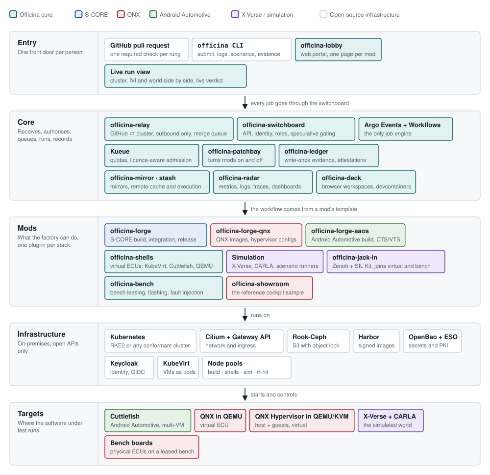
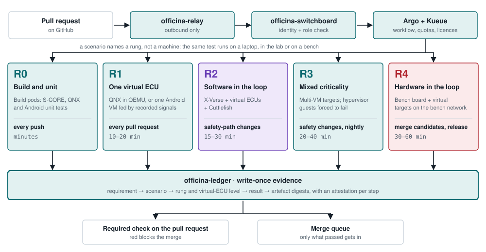
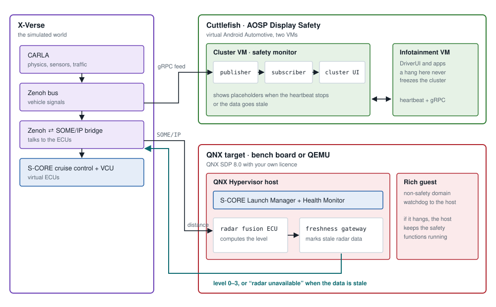
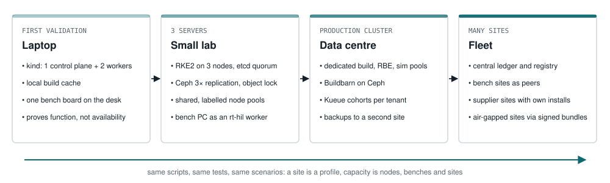

<!-- SPDX-License-Identifier: Apache-2.0 -->

  <picture>
    <source media="(prefers-color-scheme: dark)" srcset="https://raw.githubusercontent.com/officina-sdv/.github/main/brand/officina-lockup-dark.svg">
    
  </picture>

# Officina SDV

**The open-source, on-premises software factory for the Software-Defined Vehicle.**

*Officina* is Latin and Italian for "workshop": the place where a vehicle is built, tuned, repaired and checked before it goes on the road. Officina SDV does that job for vehicle software.

The industry is converging on shared open-source vehicle software: **Eclipse S-CORE** as the middleware and **X-Verse** as the co-simulation environment. Officina SDV is the factory around that software. It builds it, tests it in simulation and on real hardware, and keeps the proof that it works. It runs in your own data centre, next to your test lab, and you work with it from GitHub.

> **Status:** this page describes Officina SDV 1.0, the complete platform. See [officina-sdv](https://github.com/officina-sdv/officina-sdv) for the current release.

---

## Why Officina SDV

Every OEM and Tier-1 that adopts S-CORE has to build the same factory: the same build farm, the same test rigs, the same evidence plumbing. That costs a lot and gives no one an advantage over anyone else.

| Today | With Officina SDV |
|---|---|
| Each company builds and maintains its own CI, simulation and HiL tooling | One open platform, shared and maintained in the open |
| Simulation and bench tests are separate lab activities, run by hand | Simulation and real ECUs run on every pull request |
| Safety evidence is collected by hand before an audit | Evidence is recorded automatically by every pipeline, in write-once storage |
| Cloud factories target one OS, one cloud and one company | On-prem, open APIs, built for collaboration between OEMs and Tier-1s |

## Two things, kept apart

| | The factory: **Officina SDV** | The reference car: **officina-showroom** |
|---|---|---|
| What it is | An on-premises platform on Kubernetes. It takes a pull request, builds, starts virtual targets or leases a bench, runs scenarios, gives a verdict and stores the evidence | A sample cockpit that the factory builds and tests end to end. It combines QNX (safety), Eclipse S-CORE (middleware), AOSP Display Safety (the cluster) and X-Verse (the simulated world) |
| What it knows | How to *build and test* automotive software. There is nothing automotive inside it | How a mixed-criticality cockpit reacts when a sensor goes stale or a domain hangs |
| What you do with it | Install it once, next to your lab | Use it as a starting point, then swap it for your own software. The factory stays the same |

## Architecture

  <picture>
    <source media="(prefers-color-scheme: dark)" srcset="https://raw.githubusercontent.com/officina-sdv/.github/main/diagrams/platform-layers-dark.svg">
    
  </picture>

Top to bottom: who uses it, the core that receives and runs every job, the mods that know each software stack, the on-premises infrastructure, and the targets where the software under test runs. The core and the infrastructure are the same for everyone. Everything stack-specific is a mod.

## What a pull request goes through

  <picture>
    <source media="(prefers-color-scheme: dark)" srcset="https://raw.githubusercontent.com/officina-sdv/.github/main/diagrams/pull-request-flow-dark.svg">
    
  </picture>

1. A developer opens a pull request on GitHub. **officina-relay**, inside your cluster, picks up the event over an outbound connection. No inbound firewall port is needed.
2. **officina-switchboard** checks who the person is and whether they may run that workflow. Pull requests from forks get no secrets and no bench.
3. **Argo** creates the workflow from a mod's template, and **Kueue** admits it when capacity and, for QNX, a licence are free.
4. The change climbs the **shift-left ladder**: build and unit tests on every push (R0), one virtual ECU on every pull request (R1), software in the loop with X-Verse (R2), mixed-criticality virtual targets (R3), and the real bench only for merge candidates (R4).
5. **officina-ledger** records requirement → scenario → rung → result → exact versions, with an attestation per step, in storage that cannot be changed afterwards.
6. The pull request gets one required check per rung. A red check blocks the merge, and the merge queue only lets in what passed. Logs and evidence stay in your data centre.

A scenario names a rung, not a machine, so the same test runs on a laptop, in the lab and on the bench. A passing virtual result never counts as a hardware result. A plausible but wrong fix stays red: **closed-loop validation catches what code review alone misses.**

## The reference cockpit

  <picture>
    <source media="(prefers-color-scheme: dark)" srcset="https://raw.githubusercontent.com/officina-sdv/.github/main/diagrams/reference-cockpit-dark.svg">
    
  </picture>

**officina-showroom** is a sample mod that the factory builds and tests like any customer software. X-Verse drives the scenario. The radar fusion ECU runs on QNX, under the S-CORE launch and health managers. A freshness gateway marks the radar data stale when the sensor goes away, and the cluster on AOSP Display Safety shows "radar unavailable" instead of an old value. QNX draws nothing; it supervises and decides whether the data is still valid. The cluster keeps running when the infotainment VM hangs, and the safety functions keep running when the rich guest hangs.

The same cockpit runs fully virtual (Cuttlefish and QNX in QEMU) or with the QNX target on a real bench board. The showroom is a demonstration, not a certified safety product.

## What you get

| Capability | What it does |
|---|---|
| **Build and integration** | Bazel builds of S-CORE for Linux, QNX, AutoSD and EB corbos Linux targets, QNX images and hypervisor configurations, and Android Automotive builds with CTS/VTS. Shared remote cache and remote execution. Known-good module sets, docs-as-code and traceability gates |
| **Virtual ECUs** | S-CORE images, QNX in QEMU, the QNX Hypervisor with its guests, and multi-VM Cuttlefish, all as workloads on Kubernetes, for tests and for long-lived developer shells |
| **Simulation in the loop** | Hosting for X-Verse co-simulation with CARLA. Virtual ECUs plug into scenarios through Zenoh and Vector SIL Kit. Scenario runs, parameter sweeps and replay |
| **Hardware in the loop** | Test benches as leased cluster resources, with per-lease isolated bench networks, signed flashing, time sync, fault injection and CAN and SOME/IP gateways. The same release runs on virtual and physical ECUs |
| **Live run view** | Cluster, infotainment and the simulated world side by side, with the ECU state, timing and the verdict as the run happens, and replay afterwards |
| **Evidence by default** | Requirement → scenario → rung → result → artefacts, tool versions and bench identity, in write-once storage. One query answers "what proves this requirement?" Assessor-ready export |
| **Signed releases** | Every image and release is signed and ships with an SBOM and build provenance |
| **OEM ↔ Tier-1 collaboration** | Isolated tenants, signed supplier deliveries, and evidence exchange between separate installations. Supplier IP stays protected |
| **Developer experience** | GitHub as the front door, a CLI, a web portal, browser workspaces and devcontainers, consoles for virtual and physical ECUs, and AI-assisted failure review on a self-hosted model |
| **Extensible with mods** | Every capability is a mod. Add your own tools, toolchains and benches as private mods, without forking |

## Components

| Component | Role |
|---|---|
| `officina` | Command-line client: log in, submit, wait, logs, artefacts, scenarios, evidence |
| **officina-switchboard** | The API every job goes through: catalog, submit, logs, artefacts, role checks, speculative gating of merge candidates |
| **officina-lobby** | Web portal: tools, administration, one page per mod, the live run view |
| **officina-relay** | GitHub adapter: pull-request events in, checks and merge-queue results out |
| **officina-patchbay** | Enables and disables mods, resolves their dependencies, pins revisions |
| **officina-bootloader** | Deployer: plan, apply and destroy, including air-gapped installs from offline bundles |
| **officina-forge** · **forge-qnx** · **forge-aaos** | Build, integration, images, tests, gates and releases for S-CORE, QNX and Android Automotive |
| **officina-stash** | Bazel remote cache and remote execution |
| **officina-shells** | Virtual ECUs: S-CORE images, QNX in QEMU, the QNX Hypervisor, Cuttlefish |
| **officina-jack-in** | Plugs virtual and physical ECUs into a simulated scenario |
| **officina-bench** | Hardware-in-the-loop benches: inventory, leasing, flashing, time sync, bus gateways, fault injection |
| **officina-ledger** | Evidence index and write-once store |
| **officina-mirror** | Git, registry, package, AOSP and toolchain mirrors for offline sites |
| **officina-radar** | Metrics, logs, traces and dashboards |
| **officina-deck** · **officina-tty** · **officina-uplink** | Browser workspaces · consoles and flashing · gateway for AI agents and IDEs |
| **officina-showroom** | The reference cockpit sample |

## Security by design

The architecture was threat-modelled before the code, following ISO/SAE 21434 adapted to a development platform. What that means for you:

- Per-user identity end to end, a role check on every job, and no static keys.
- Virtual targets run unprivileged. Code from untrusted pull requests never reaches secrets, benches or shared caches.
- Build caches and remote-execution workers are separated by trust level, and releases are rebuilt without a cache.
- Every bench lease gets its own authenticated network with no route to the cluster, and only signed images are flashed.
- Rung, target and bench identity come from build provenance, not from what the job says about itself.
- Proprietary toolchains such as the QNX SDP stay inside your installation and are never sent to public CI.
- Every reused third-party component is pinned by digest and goes through a cooling-off period before an upgrade.

## One code base, four deployment profiles

  <picture>
    <source media="(prefers-color-scheme: dark)" srcset="https://raw.githubusercontent.com/officina-sdv/.github/main/diagrams/deployment-profiles-dark.svg">
    
  </picture>

Every script and test reads a target profile. Adding a site means adding a profile, not changing code. Capacity grows by adding nodes to a pool, benches to a site, or sites to a fleet.

## Principles

- **Open source.** Apache-2.0, the same licence as Eclipse S-CORE. Every shipped dependency has an OSI-approved licence.
- **On-premises first.** Runs where licences, test benches and safety evidence must stay, including fully air-gapped sites.
- **Open APIs, no lock-in.** Kubernetes, S3, OIDC, OCI and a Vault-compatible secrets API. No mandatory commercial component. Runs on any conformant Kubernetes.
- **One workflow engine.** Argo runs every job. GitHub only starts jobs and shows their results.
- **Security by design.** Per-user identity, role checks on every job, no static keys, signed images only, no secrets or benches for untrusted code.
- **Evidence by default.** Proof is a side effect of everyday development, not a separate project before an audit.
- **Closed-loop validation, tests first.** A safety-relevant change is accepted on a scenario verdict in simulation or on a bench, not on unit tests alone.
- **Reproducible.** Inputs are pinned by commit or digest, and every run records the exact revisions it used.

Officina SDV produces and keeps evidence for safety and cybersecurity work. It does not by itself make a product safe or compliant: the safety argument remains the integrator's responsibility.

Officina SDV reuses proven open-source projects instead of rewriting them: Kubernetes, Cilium, Rook-Ceph, Harbor, OpenBao, Keycloak, KubeVirt, Argo CD, Argo Workflows and Events, Kueue, Buildbarn, Cuttlefish, QEMU, Zenoh, Vector SIL Kit, Jumpstarter, Eclipse openDuT, sphinx-needs, Witness, OpenTelemetry, Prometheus, Thanos, Loki, Tempo and Grafana.

## Repositories

| Repository | Content |
|---|---|
| [officina-sdv](https://github.com/officina-sdv/officina-sdv) | The platform: core services, mods, deployer, docs |
| [.github](https://github.com/officina-sdv/.github) | This organisation profile, its diagrams and shared community files |

## Get involved

If your organisation builds on Eclipse S-CORE or X-Verse, Officina SDV lets you stop paying for the same factory twice. You can:
- **sponsor** the core team and the next milestones;
- **pilot** Officina SDV in your lab, as an OEM or a Tier-1;
- **contribute** engineers, mods, test benches or hardware;
- **join** the steering of the roadmap and governance.

Start a conversation in [GitHub Discussions](https://github.com/officina-sdv/officina-sdv/discussions). Report bugs in [Issues](https://github.com/officina-sdv/officina-sdv/issues). Report security vulnerabilities privately, as described in the repository's `SECURITY.md`.
