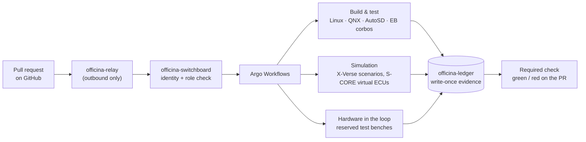

<!-- SPDX-License-Identifier: Apache-2.0 -->

  <picture>
    <source media="(prefers-color-scheme: dark)" srcset="https://raw.githubusercontent.com/officina-sdv/.github/main/brand/officina-lockup-dark.svg">
    
  </picture>

# Officina SDV

**The open-source, on-premises software factory for the Software-Defined Vehicle.**

*Officina* is Latin and Italian for "workshop": the place where a vehicle is built, tuned, repaired and checked before it goes on the road. Officina SDV does that job for vehicle software.

The industry is converging on shared open-source vehicle software: **Eclipse S-CORE** as the middleware and **X-Verse** as the co-simulation environment. Officina SDV is the factory around that software. It builds it, tests it in simulation and on real hardware, and keeps the proof that it works. It runs in your own data centre, next to your test lab, and you work with it from GitHub.

> **Status:** early development. This page describes the platform we are building. Follow progress in [officina-sdv](https://github.com/officina-sdv/officina-sdv).

---

## Why Officina SDV

Every OEM and Tier-1 that adopts S-CORE has to build the same factory: the same build farm, the same test rigs, the same evidence plumbing. That costs a lot and gives no one an advantage over anyone else.

| Today | With Officina SDV |
|---|---|
| Each company builds and maintains its own CI, simulation and HiL tooling | One open platform, shared and maintained in the open |
| Simulation and bench tests are separate lab activities, run by hand | Simulation and real ECUs run on every pull request |
| Safety evidence is collected by hand before an audit | Evidence is recorded automatically by every pipeline, in write-once storage |
| Cloud factories target one OS, one cloud and one company | On-prem, open APIs, built for collaboration between OEMs and Tier-1s |

## What a pull request goes through

1. A developer opens a pull request on GitHub.
2. A runner inside your cluster picks up the job over an outbound connection. No inbound firewall port is needed.
3. Officina SDV builds the change for every target, runs unit and integration tests on virtual ECUs, and runs the affected scenarios in simulation and on real ECUs.
4. Every result is recorded as requirement → test → result → exact versions, in storage that cannot be changed afterwards.
5. The pull request gets a required check. A red check blocks the merge. Logs and evidence stay in your data centre.

A plausible but wrong fix stays red. That is the point: **closed-loop validation catches what code review alone misses.**

## What you get

| Capability | What it does |
|---|---|
| **Build and integration** | Bazel builds of S-CORE for Linux, QNX, AutoSD and EB corbos Linux targets, with a shared remote cache and remote execution. Integration of tested module sets, docs-as-code and traceability gates, and promotion of known-good combinations |
| **Virtual ECUs** | S-CORE images as virtual machines on Kubernetes, for integration tests and long-lived developer shells |
| **Simulation in the loop** | Hosting for X-Verse co-simulation. S-CORE virtual ECUs plug into simulated scenarios. Scenario runs, parameter sweeps and replay |
| **Hardware in the loop** | Test benches as reservable cluster resources, with time sync and CAN and SOME/IP gateways. The same release runs on virtual and physical ECUs |
| **Evidence by default** | Requirement → test → result → artefacts, tool versions and bench identity, in write-once storage. One query answers "what proves this requirement?" Assessor-ready export |
| **Signed releases** | Every image and release is signed and ships with an SBOM and build provenance |
| **OEM ↔ Tier-1 collaboration** | Isolated tenants, signed supplier deliveries, and evidence exchange between separate installations. Supplier IP stays protected |
| **Developer experience** | GitHub as the front door, a CLI, a web portal, browser workspaces, consoles for virtual and physical ECUs, and AI-assisted failure review on a self-hosted model |
| **Extensible with mods** | Every capability is a mod. Add your own tools, toolchains and benches as private mods, without forking |

## Components

| Component | Role |
|---|---|
| `officina` | Command-line client: log in, submit, wait, logs, artefacts, scenarios, evidence |
| **officina-switchboard** | The API every job goes through: catalog, submit, logs, artefacts, role checks |
| **officina-lobby** | Web portal: tools, administration, one page per mod |
| **officina-relay** | GitHub adapter: pull-request events in, checks and promotion pull requests out |
| **officina-patchbay** | Enables and disables mods, resolves their dependencies, pins revisions |
| **officina-bootloader** | Deployer: plan, apply and destroy, including air-gapped installs from offline bundles |
| **officina-forge** | S-CORE build, integration, images, tests, gates and releases |
| **officina-stash** | Bazel remote cache and remote execution |
| **officina-shells** | S-CORE virtual ECUs |
| **officina-jack-in** | Plugs an S-CORE virtual ECU into a simulated scenario |
| **officina-bench** | Hardware-in-the-loop benches: inventory, reservation, time sync, bus gateways |
| **officina-ledger** | Evidence index and write-once store |
| **officina-mirror** | Git, registry, package and toolchain mirrors for offline sites |
| **officina-radar** | Metrics, logs, traces and dashboards |
| **officina-deck** · **officina-tty** · **officina-uplink** | Browser workspaces · consoles and flashing · gateway for AI agents and IDEs |

## Principles

- **Open source.** Apache-2.0, the same licence as Eclipse S-CORE. Every shipped dependency has an OSI-approved licence.
- **On-premises first.** Runs where licences, test benches and safety evidence must stay, including fully air-gapped sites.
- **Open APIs, no lock-in.** Kubernetes, S3, OIDC, OCI and a Vault-compatible secrets API. No mandatory commercial component. Runs on any conformant Kubernetes.
- **Security by design.** Per-user identity end to end, role checks on every job, no static keys, signed images only, no secrets or benches for untrusted code.
- **Evidence by default.** Proof is a side effect of everyday development, not a separate project before an audit.
- **Spec-driven.** Every feature starts as a public specification traced to requirements, and goes through test-first implementation.

Officina SDV produces and keeps evidence for safety and cybersecurity work. It does not by itself make a product safe or compliant: the safety argument remains the integrator's responsibility.

Officina SDV runs on proven open-source projects: Kubernetes, Cilium, Rook-Ceph, Harbor, OpenBao, Keycloak, KubeVirt, Argo CD, Argo Workflows and Events, Kueue, OpenTelemetry, Prometheus, Loki, Tempo and Grafana.

## Repositories

| Repository | Content |
|---|---|
| [officina-sdv](https://github.com/officina-sdv/officina-sdv) | The platform: specifications, core services, mods, deployer, docs |
| [.github](https://github.com/officina-sdv/.github) | This organisation profile and shared community files |

## Get involved

If your organisation builds on Eclipse S-CORE or X-Verse, Officina SDV lets you stop paying for the same factory twice. You can:
- **sponsor** the core team and the next milestones;
- **pilot** Officina SDV in your lab, as an OEM or a Tier-1;
- **contribute** engineers, mods, test benches or hardware;
- **join** the steering of the roadmap and governance.

Start a conversation in [GitHub Discussions](https://github.com/officina-sdv/officina-sdv/discussions). Report bugs in [Issues](https://github.com/officina-sdv/officina-sdv/issues). Report security vulnerabilities privately, as described in the repository's `SECURITY.md`.

---

Officina SDV is an independent open-source project. It is not affiliated with or endorsed by the Eclipse Foundation, the Eclipse S-CORE project, the X-Verse project, Google, Accenture or the Horizon SDV project. QNX software and licences are not included; building QNX targets requires a QNX SDP licence from BlackBerry QNX. All product names and trademarks belong to their respective owners.
